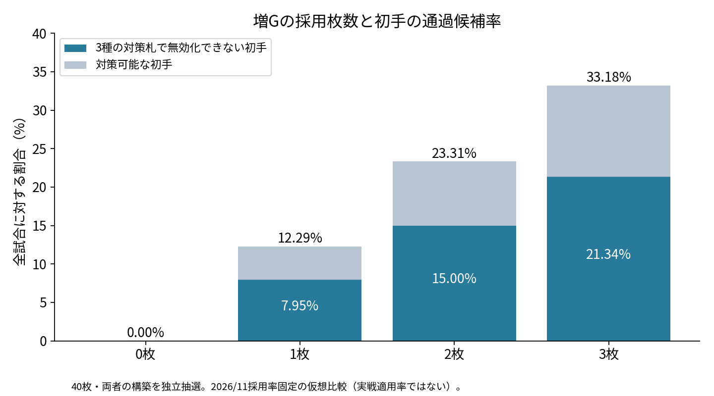

# 第1回 — 増殖するGの初手通過候補率

検証日：2026年11月27日

## 概要

先攻プレイヤーの第1ターン開始時点で、後攻が増殖するGを初手5枚に持ち、先攻の初手に灰流うらら・墓穴の指名者・有効な抹殺の指名者がない確率を計算します。抹殺の宣言対象がデッキ内に残る条件も反映します。

2026年11月5日の公開採用率、40枚、採用者が増G1枚・うらら3枚・抹殺1枚、採用の独立性を仮定した基準モデルでは、初手通過候補率は厳密計算で **7.9521%**、100万試行で **7.9519%** です。58条件で合計5,800万試行を実施し、通過候補率の厳密値との差の絶対値の最大は0.10863ポイントでした。

これは実戦適用率でも勝率でもありません。うららの枚数分布・同時採用率・実際のプレイ順序などは未確認です。実在WCS構築は11件のサンプルであり、大会全体の代表標本ではありません。

詳しい結果、前提、考察、参考資料は [記事原稿](article.md) を参照してください。



## ファイル一覧

| ファイル | 内容 |
|---|---|
| [article.md](article.md) | note掲載用原稿・出典 |
| [simulate.py](simulate.py) | 厳密計算、乱数抽選、グラフ生成 |
| [requirements.txt](requirements.txt) | 依存ライブラリのバージョン |
| [deck_profiles.csv](deck_profiles.csv) | WCS構築11件の対象カード枚数・個別出典URL |
| [results.csv](results.csv) | 58条件の計算結果 |
| [wcs_observed.csv](wcs_observed.csv) | 大会全ターンの観測適用試合率（2023〜2025は復元値） |
| [drawtrap_overlap_exact.csv](drawtrap_overlap_exact.csv) | ドロー系誘発の初手重複の厳密計算 |
| [01_copies.png](01_copies.png) / [02_wcs.png](02_wcs.png) / [03_deck_size.png](03_deck_size.png) | 結果のグラフ |
| [run_log.txt](run_log.txt) | 元の100万試行実行ログ |

## 追試手順

Python 3.11以上（検証環境：Python 3.13.5、NumPy 2.3.5、Matplotlib 3.10.8）。以下はリポジトリを取得・展開した後、リポジトリのルートから実行する例です。

```shell
cd maxx-c/01-opening-hand
python -m pip install -r requirements.txt
python simulate.py --trials 1000000
```

動作確認だけなら `python simulate.py --trials 10000` を実行してください。

乱数シードは条件ごとに `2026112700 + 条件番号（0始まり）` で固定します。CSVとPNGはスクリプトと同じディレクトリに上書き出力されます。公開済みの結果を残したい場合はディレクトリを別の場所にコピーしてから実行してください。日本語グラフの再生成には Noto Sans CJK JP フォントが必要です（同梱しません）。フォントがなくても確率計算は可能ですが、グラフの日本語表示が崩れることがあります。環境差により乱数結果や画像のバイト列が完全一致しない場合があります。

## CSVの読み方

確率は0〜1で記録しています。`*_pp` はパーセントポイントです。

- `hold`: 後攻初手に増Gがある。
- `blocked`: hold かつ先攻初手に指定3種の有効な対策札がある。
- `open`: hold かつ先攻初手に指定3種の有効な対策札がない。
- `*_exact`: 厳密計算、`*_mc`: モンテカルロ推定。
- `naive_open_exact`: 抹殺の宣言対象が必ず残っているとする比較値。
- `crossout_no_target_joint_exact`: 後攻が増Gを持ち、先攻が抹殺を持つが対象Gがデッキ内にない確率（他の対策札と重複あり）。
- `open_error_pp`: モンテカルロ推定値から厳密値を引いた差。
- `open_mc_se_pp`: モンテカルロ推定の理論標準誤差。

`drawtrap_overlap_exact.csv` は厳密計算のみです。大会観測値は初手モデルとは異なる指標です。`wcs_observed.csv` の `reconstructed` は公表値から復元した値、`reported` は元記事で公表値として扱った値を示します。

## 出典と制約

採用率は [2026年11月5日 Master Duel Meta掲載値](https://mdm.app.duellinksmeta.com/articles/news/november-05-2026/card-usage-update) を基準としています。WCS構築の出典は `deck_profiles.csv`、大会観測値その他の出典は `article.md` の参考資料に記載しています。外部サイトの利用条件は各サイトを確認してください。全試合ログの独立再集計は実施していません。
