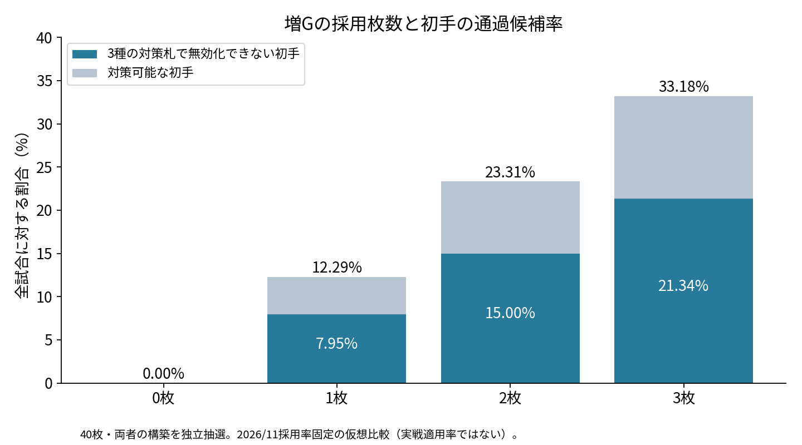
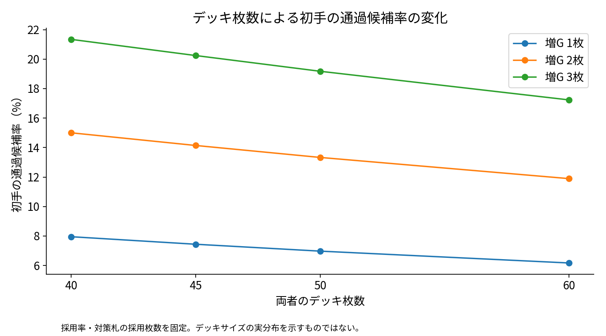
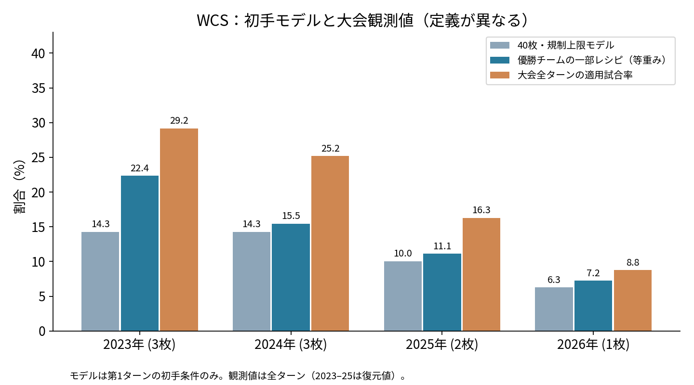

# 【遊戯王MD】制限カードの増殖するGは何％の初手で通るのか――5,800万回のシミュレーションで検証

検証ノート｜増殖するG禁止論・追加検証 第1回（2026年11月27日）

## はじめに

前稿では《増殖するＧ》（以下、増G）の禁止と、先攻制圧への追加規制・後攻支援の拡充を提案した。そこで残った疑問の一つが、現在の増Gがどの程度の頻度で効果を発揮できるのか、という問題である。

禁止反対派からは「制限でも増Gは後攻の重要な救済手段である」「墓穴が禁止された現在、増Gは以前より通りやすい」という反論が考えられる。これは検討に値する。今回は実際の採用率、世界大会の構築例、対策札の条件を使って、まず初手の段階でどこまで説明できるかを検証した。

**結論を先に述べる。2026年11月の採用率を用いた40枚デッキの基準モデルでは、後攻が増Gを初手に持ち、先攻側がうらら・墓穴・抹殺で即座に無効化できない割合は7.95%となった。** ただし、うららの採用枚数次第では10%を超える。7.95%は実戦適用率でも禁止後の勝率予測でもない。

## 1. 何を検証するのか

検証対象は、先攻プレイヤーの第1ターンが始まった時点の、双方の初手5枚である。後攻の通常ドローはまだ行われていない。

本稿では次の指標を区別する。

| 指標 | 定義 |
|---|---|
| 初手保有率 | 後攻側の初手5枚に増Gが1枚以上存在 |
| 対策可能率（全試合換算） | 後攻側が増Gを保有し、先攻側が指定の対策札で無効化可能 |
| 初手通過候補率 | 後攻側が増Gを保有し、先攻側が指定の対策札で無効化できない |
| 大会適用試合率 | 公開リプレイ集計で、全ターンを通して後攻側の増Gが少なくとも1回通った試合の割合 |

初手通過候補率は、増Gを直ちに発動し、他の効果や追加ドローが発生しないと仮定した場合の指標である。対策札の消費、発動の遅延、展開中断、テーマ内妨害、ドローの禁止、墓地へ送れない状況などはモデル化していない。効果が通ってもドローが0枚の場合がある。反対に、初手に増Gがなくても後で引くことがある。

## 2. 検証方法

### 2-1. 規制状況と採用率

| 環境 | 増G上限 | うらら上限 | 墓穴上限 | 抹殺上限 |
|---|---:|---:|---:|---:|
| WCS2023 | 3 | 3 | 2 | 1 |
| WCS2024 | 3 | 3 | 2 | 1 |
| WCS2025 | 2 | 3 | 2 | 1 |
| WCS2026 | 1 | 3 | 1 | 1 |
| 2026年11月MD | 1 | 3 | 0 | 1 |

WCSはチーム単位の共有カードルールを持つため、上限まで採用できることと、実際に採用されていることは異なる。後述する上限モデルは通常の各デッキに対する上限を用いた仮想比較である。大会の構築分布を再現するものではない。

2026年11月5日の最高ランク帯に関するゲーム内カード使用率の外部転載値を用いる。[1]

| カード | 採用率 |
|---|---:|
| 増G | 98.3% |
| 灰流うらら | 94.8% |
| 抹殺の指名者 | 41.1% |
| マルチャミー・フワロス | 71.7% |
| マルチャミー・プルリア | 30.2% |

採用率は採用者の枚数分布を表さない。本稿では、基準条件として採用者は増G・抹殺を1枚、うららを3枚入れるものとする。また、採用の有無は独立、双方のデッキ選択も独立と仮定した。うらら1～3枚について感度分析を行う。

### 2-2. 抹殺の条件を反映する

抹殺の指名者は、自分のメインデッキに宣言したカードが残っていなければそのカードを無効化できない。増Gが1枚制限で、その1枚が自分の初手に存在する場合、手札の抹殺は増Gに対して機能しない。[2]

初手の増Gの枚数を g_h、採用枚数を g、うらら・墓穴・抹殺の初手枚数をそれぞれ a_h、b_h、c_h とする。先攻側の対策可能条件は次のいずれかである。

- a_h が1以上
- b_h が1以上
- c_h が1以上、かつ g_h が g 未満

墓穴は相手の墓地に増Gがある通常の発動状況を前提とする。対策可能な場合は必ず無効化するものとし、チェーンによる別の妨害は対象外とする。

### 2-3. 厳密計算とモンテカルロ法

N枚のデッキに増Gがg枚ある場合、初手率は次式で求められる。

$$P(\mathrm{hold})=1-\frac{\binom{N-g}{5}}{\binom{N}{5}}$$

先攻の初手については、4種類の対象カードとその他のカードに分類し、多変量超幾何分布によって全ての枚数の組合せを列挙する。各組合せの確率は、各カテゴリの組合せ数の積を全初手の組合せ数で割ったものである。

双方のデッキと初手が独立なら、初手通過候補率は「後攻初手保有率 × 先攻の対策不能確率」で求められる。採用率モデルではデッキ構築の各組合せについても確率で重み付けする。

これとは別に、PythonとNumPyでデッキの種類を抽選し、カードを戻さず5枚引く操作を超幾何乱数で再現した。58条件、各100万試行、合計5,800万試行である。乱数シードを各条件について固定し、厳密値と照合した。勝率を仮定して乱数を発生させたものではない。

## 3. 現環境の増Gはどれほど通るのか

40枚デッキの基準モデルの結果は次の通りである。

| 指標 | 厳密値 | 100万回抽選 |
|---|---:|---:|
| 初手通過候補率 | 7.9521% | 7.9519% |

全試合を分解すると、初手に増Gなし87.7125%、増Gあり・対策可能4.3354%、増Gあり・対策不能7.9521%となる。

対策札の扱いを変えた場合は以下の通りである。

| 条件 | 初手通過候補率 |
|---|---:|
| 対策札を考慮しない | 12.2875% |
| うららのみ考慮 | 8.3555% |
| うらら・抹殺を考慮（抹殺に対象が必ずあると仮定） | 7.8941% |
| 抹殺の対象がデッキに残っている条件まで考慮 | 7.9521% |

抹殺の条件を正しく反映すると、通過候補率は単純化したモデルより0.0580ポイント上昇した。基準モデルの対策可能率を増G保有率で割ると約35.3%であり、増Gを引いた場合のおよそ3分の1は指定の対策札で無効化可能となる。

1000試合に換算すれば、約123試合で初手に増Gを持ち、そのうち約43試合では相手が対策可能、約80試合では対策不能となる計算である。勝利数の予測ではない。

### 3-1. 反対派に有利な条件も検証する

「うらら採用者が全員3枚採用しているとは限らない」という指摘は正しい。採用者のうららの枚数を変えて計算した。

| 採用者のうらら枚数 | 初手通過候補率 |
|---|---:|
| 1枚 | 10.3301% |
| 2枚 | 9.0744% |
| 3枚 | 7.9521% |

このため、現環境の増G適用率が必ず7～8%になるとはいえない。7.95%は特定の構築条件に対応する数値であり、現実の枚数分布や同時採用率を得られれば再計算する必要がある。

さらに、同じ40枚・増G1枚のデッキを固定し、対策札を変える比較も行った。こちらは採用率を使わず、両者が増Gを確実に1枚採用するモデルである。

| 先攻の対策札 | 初手通過候補率 |
|---|---:|
| なし | 12.5000% |
| うらら3 | 8.2806% |
| うらら3・抹殺1 | 7.2859% |
| うらら3・墓穴1・抹殺1 | 6.2806% |
| うらら3・墓穴2・抹殺1 | 5.3896% |

墓穴禁止によって増Gが通りやすくなる、という反論は、同じ構築を固定した比較では支持される。墓穴1枚から0枚にすると、全試合での通過候補率は約1.01ポイント増える。ただし、それでも初手に増Gを持てる割合そのものは12.5%にとどまる。ここでの差は墓穴の規制が勝率にもたらす効果ではない。

## 4. 1枚制限の影響を分離する

現環境の採用率・対策札の条件を固定し、増Gの採用枚数のみを両者で変化させた仮想比較である。2枚・3枚は現行規制では使用できないため、過去の実環境を再現したものではない。

| 増G採用者の枚数 | 初手保有率 | 対策可能率 | 初手通過候補率 |
|---|---:|---:|---:|
| 0 | 0.00% | 0.00% | 0.00% |
| 1 | 12.29% | 4.34% | 7.95% |
| 2 | 23.31% | 8.31% | 15.00% |
| 3 | 33.18% | 11.84% | 21.34% |

3枚から1枚になると、同一モデルの通過候補率は約62.7%低下する。対策札を固定しても、初手の救済機会は規制枚数によって大きく変わるのである。

一方、1枚制限であっても対策札が一切機能しないなら、40枚デッキで初手に増Gが存在する理論値は12.5%である。これは初手に限定した上限であって、全ターンの適用率の上限ではない。

### デッキ枚数の影響

| デッキ枚数 | 増G1枚 | 増G2枚 | 増G3枚 |
|---|---:|---:|---:|
| 40枚 | 7.95% | 15.00% | 21.34% |
| 45枚 | 7.44% | 14.14% | 20.24% |
| 50枚 | 6.97% | 13.33% | 19.18% |
| 60枚 | 6.17% | 11.89% | 17.23% |

両者のデッキ枚数を同じにして比較すると、大きなデッキほど対策札を引きにくくなるが、増Gそのものも引きにくくなる。この条件では後者の影響が上回った。実戦におけるデッキ枚数の分布は未確認である。

## 5. 実在するWCSのデッキで比較する

世界大会の公式デッキレシピから、優勝チームの11構築について対象カードの実枚数を確認した。抽出したのは以下の構築である。全参加者のレシピを無作為抽出した標本ではない。

| 年度・選手／テーマ | 総枚数 | 増G | うらら | 墓穴 | 抹殺 |
|---|---:|---:|---:|---:|---:|
| 2023 Josh／ナチュル神碑 | 40 | 3 | 3 | 0 | 0 |
| 2023 Josh／ビーステッド・ドラゴンリンク | 40 | 3 | 3 | 0 | 0 |
| 2023 Emre／ラビュリンス | 40 | 3 | 3 | 0 | 0 |
| 2024 Ryan／炎王スネークアイ | 42 | 3 | 3 | 2 | 1 |
| 2024 Ryan／VS | 40 | 3 | 3 | 2 | 0 |
| 2025 Mist／ライゼオル | 40 | 2 | 3 | 2 | 1 |
| 2025 Luka／M∀LICE | 40 | 2 | 3 | 2 | 0 |
| 2025 N3sh／メメント | 43 | 2 | 3 | 2 | 0 |
| 2026 CER.Sana／Kewl Tune | 40 | 1 | 3 | 1 | 1 |
| 2026 CER.subaduck／Radiant Typhoon Zoodiac | 40 | 1 | 3 | 1 | 0 |
| 2026 CER.subaduck／Branded Dracotail | 40 | 1 | 3 | 0 | 0 |

出典：公式カードデータベースの個別レシピ。全URLは添付の deck_profiles.csv に記録した。[3]

2026年の3例では、増G・うららの枚数が同じでも墓穴・抹殺の採用数が異なる。各構築同士の仮想ミラー対戦では、通過候補率はそれぞれ6.28%、7.16%、8.28%になる。

次に各年の実在レシピから双方を等確率・独立に選んだ場合と、全員が上限まで採用した40枚モデルを比較した。等確率モデルは実際の大会でのデッキ選択や対戦組合せを再現していない。チームメイト同士の構築を対戦させる抽選も含む。

| 年度 | 増G上限 | 40枚上限モデル | 実在構築サンプルの等重みモデル | 大会の観測適用率 |
|---|---:|---:|---:|---:|
| 2023 | 3 | 14.28% | 22.36% | 29.17% |
| 2024 | 3 | 14.28% | 15.47% | 25.19% |
| 2025 | 2 | 10.05% | 11.12% | 16.29% |
| 2026 | 1 | 6.28% | 7.24% | 8.76% |

大会の観測値は前稿と同じ公開リプレイ集計を使用した。2023～2025年は公表勝率に整合する適用試合数の復元値（35/120、68/270、43/264）、2026年は公表された24/274である。[4–7]

ここでは観測値の方が高い。これはモデルが誤りである証拠でも、正しいという証拠でもない。大会統計は全ターンの適用を数えるが、モデルは第1ターン開始時の初手条件だけを対象とする。サンプルの構築偏り、途中のドロー、対策札の消費、他の効果も差の要因になり得る。実測に近づけるためにパラメータを事後調整してはいない。

**規制上限だけを全員の実採用枚数とする計算は不十分である。** とりわけWCSでは共有ルールによる偏りがあるため、全レシピと実際の使用頻度が必要となる。

## 6. マルチャミーとの重複

フワロス、プルリアの公開採用率を使い、増Gとの初手重複を厳密計算した。各採用の有無は独立で、マルチャミーの採用者はそれぞれ同じ枚数を採用する仮定とした。実際の採用枚数は不明であり、ニャルス、通常召喚条件、適用範囲、対策札、禁止後の構築変更は含めない。

| 採用者の各マルチャミー枚数 | 増Gも含めて1枚以上保有 | 増Gを抜いた場合 | 増Gのみ保有 |
|---|---:|---:|---:|
| 1枚 | 23.48% | 12.46% | 11.02% |
| 2枚 | 33.05% | 23.14% | 9.90% |
| 3枚 | 41.18% | 32.27% | 8.91% |

増Gを禁止したとき、ドロー系誘発を1枚以上持てる確率は他のカードが固定なら低下する。この点は増G維持論に有利であり、認めるべきである。ただし、禁止によって空いた枠を別の後攻札に置換することは可能であり、効果範囲の異なるカードを同一視することもできない。マルチャミーが代替として十分かどうかは、実際の展開ルートを使った後続検証に委ねる。

## 7. 反対意見への回答

**反論：墓穴禁止で増Gが通りやすくなったのだから、1枚制限でも有用なのではないか。**

回答：同一構築の比較で通りやすくなることは確認できた。しかし、墓穴が消えても初手保有率の低さは解消されない。有用性は否定しないが、3枚時代と同じ再現性を持つ後攻支援として評価するのは適切ではない。

**反論：初手率だけでは増Gの抑止力を評価できない。**

回答：正しい。今回測ったのは初手に関する機会だけである。増Gを事前に警戒したルート変更、発動後の展開縮小、対策札の消費による利益は対象外だ。これらを含めた実際の価値の評価は次回以降に行う。

**反論：初手通過候補率が8%でも、その8%で後攻が救われるなら必要ではないか。**

回答：その試合の救済が重要であることは認める。しかし、救済が必要なことと、その救済を制限カード1枚に委ねることの妥当性は別である。より多くの試合で後攻を支援できる規制・カード設計との比較が必要であり、増Gの有用性だけでは現状維持を最適とする根拠にならない。

## 8. 結論

今回の計算で確認できたのは、増Gの初手からの利用機会が規制枚数に強く依存し、対策札の採用状況によっても変化することである。墓穴禁止による通過候補率の上昇も否定しない。基準条件では7.95%だが、うららの枚数が少ない場合には10%を超える。都合のよい一つの数字を現環境の確定値として扱うべきではない。

それでも、40枚デッキに1枚入れた増Gを第1ターン開始時に持てる確率は、対策札が存在しなくても12.5%である。

**極めて強力なカードであることと、安定した後攻支援手段であることは別だ。**

私は引き続き、増Gを禁止し、先攻制圧への直接的な対策と幅広い後攻支援を組み合わせる方針を支持する。ただし、今回の検証だけで禁止後の勝率や環境改善を証明したわけではない。後続の検証では、実際のデッキの展開ルートから増Gの事前・事後の抑止力と、代替支援の効果を評価する。

## 検証データの公開と追試

実行環境：Python、NumPy 2.3.5。各条件100万試行、条件ごとの固定乱数シード、58条件の初手通過候補率について厳密値との差の絶対値は最大0.10863ポイントだった。基準モデルの100万試行の標準誤差は約0.027ポイントであり、試行回数による誤差と入力仮定の誤差は区別する必要がある。

添付の simulate.py、deck_profiles.csv を同じディレクトリに置き、`python simulate.py` で再計算できる。グラフも生成する。CSVの確率は0～1で記録している。

## 参考資料

1. [2026年11月5日のカード使用率（Master Duel Meta）](https://mdm.app.duellinksmeta.com/articles/news/november-05-2026/card-usage-update)、[DuelIndex転載](https://duelindex.com/en/updates/MD-20261105-CARDUSAGE)
2. [抹殺の指名者を含む公式デッキDB・カード詳細](https://www.db.yugioh-card.com/yugiohdb/member_deck.action?cgid=951b1e71a6a30f01ee6f025086d06941&dno=92&request_locale=en)
3. [WCS2023公式](https://www.konami.com/yugioh/worldchampionship/2023/en/)、[WCS2024公式](https://www.konami.com/yugioh/worldchampionship/2024/en/)、[WCS2026公式](https://www.konami.com/yugioh/worldchampionship/2026/ja/)、各レシピの個別URLは deck_profiles.csv 参照。
4. [WCS2023リプレイ集計（Prismachete）](https://www.reddit.com/r/masterduel/comments/15kb8w0/)
5. [WCS2024リプレイ集計（Prismachete）](https://www.reddit.com/r/masterduel/comments/1fe1pul/)
6. [WCS2025リプレイ集計（Prismachete）](https://www.reddit.com/r/masterduel/comments/1n7u5cu/wcs2025_and_maxx_c_the_statistics_gigantic_wall/)、[Master Duel Meta転載](https://www.masterduelmeta.com/articles/tournaments/maxxc-WCS2025)
7. [WCS2026手札誘発・先後勝率集計（アプカ、2026年9月4日）](https://note.com/apkallone/n/n9ccd39b48ff5)
8. [増Gの規制履歴](https://ygoprodeck.com/card/maxx-c-2021)、[抹殺の規制履歴](https://ygoprodeck.com/card/crossout-designator-10330)、[墓穴禁止の改訂](https://mdm.app.duellinksmeta.com/articles/news/august-30-2026/master-duel-forbidden-list-update)、[WCS2025規定](https://www.masterduelmeta.com/articles/quick-news/july-29-2025/wcs-rules)、[WCS2026規定](https://www.masterduelmeta.com/articles/quick-news/july-21-2026/wcs-rules)

注：公式DBのレシピに付随する現在のOCG/TCG等の禁止・制限表示は、当時のMDでの規制と異なる場合がある。レシピでは登録枚数を参照した。各大会の全レシピの抽出、ランク戦の個別デッキの全カード確認、大会リプレイの独立再集計は未実施である。
