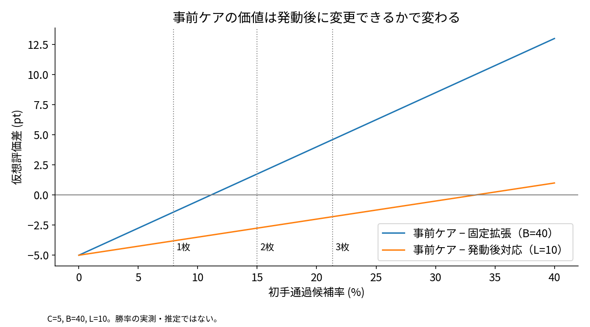

# 第2回 — 増殖するGの事前抑止と発動後対応

検証日：2026年11月27日。第1回の初手確率モデルを再利用し、増G0〜3枚の4条件で各100万回の初手抽選、3,600条件の決定論的感度分析を実施。WCS公式構築2件を参照した6ルートの条件付き展開例を比較する。対戦エンジンや勝率の学習モデルではない。

[記事全文](article.md) ｜ [第1回](../01-opening-hand/README.md)



## 実行方法

Python 3.11以上。`numpy`、`matplotlib` は requirements.txt 参照。日本語グラフ再生成には Noto Sans CJK JP を推奨（同梱なし）。

```sh
cd maxx-c/02-deterrence
python -m pip install -r requirements.txt
python simulate.py --trials 1000000
```

単独ZIP展開時は `simulate.py` があるディレクトリで実行。各条件の乱数シードは2026112800+増G枚数。日付を表すものではない。CSV・PNGは同じディレクトリに上書きされる。`opening_model.py` は第1回のコードのスナップショットで、今回利用するのは `current`、`exact`、`sim`。直接実行せず `simulate.py` を起動すること。

## ファイル

| ファイル | 内容 |
|---|---|
| article.md | note掲載用原稿・出典 |
| simulate.py / opening_model.py | 実行コードと第1回モデル |
| requirements.txt | 依存ライブラリ |
| round1_results.csv / deck_profiles.csv / wcs_observed.csv | 第1回入力・結果のスナップショット |
| route_cases.csv | 6ルートの条件、手順、到達状態、特殊召喚イベント数 |
| opening_rates.csv | 4条件の厳密値・MC値・シード |
| strategy_grid.csv / baseline.csv | 3,600条件の戦略評価・基準ケース |
| historical_scenarios.csv | WCS年度別の第1回モデルへの戦略式適用 |
| route_draws.csv / timing.csv | 条件付きドロー枚数・タイミング別の残り回数 |
| candidate_draws.csv | 追加ドローで指定候補を得る厳密確率 |
| 01_opening_rates.png / 02_strategy_thresholds.png / 03_routes.png | 図 |
| run_log.txt | 実行ログ |

## 数値と制約

確率は0〜1。`p` は初手通過候補率、`q` は増G初手保有と指定対策札の同時確率。`C` は非適用時の事前短縮費用、`B` は適用時の事前短縮対固定拡張の利益、`L` は発動後変更の費用、`K` は対策札消費の仮想費用。戦略評価は相対スコアで、実測・予測勝率ではない。`best` は同点の場合 `|` 区切りで列挙する。`no_counter` と `guaranteed_counter` は自身の手札情報を条件にした理想化モデルで、頻度は実測していない。

`route_draws.csv` の平均値は、pと固定した召喚回数の積であり、実戦のドロー枚数ではない。`mean_net_cards_if_g_always_attempted` は0召喚ルートでも増G保有時に必ず発動を試み、指定対策札を必ず使用する仮定での純手札差。実際に0召喚の相手にGを使うとは限らない。`timing.csv` は単純な残り召喚イベント数であってチェーン窓の合法性を全列挙したものではない。

`candidate_draws.csv` は増G初手保有を条件とし、追加分の候補取得率と、初手に候補ゼロかつ追加取得する同時確率を出力する。後者は初手候補ゼロでさらに条件付けした値ではない。

実在ルートはカード効果を確認した例示で、実機の実行・対戦リプレイの検証は未実施。全手札・代替ルート・他の誘発・先攻側の構築変更を網羅しない。年度別構築の合法性は大会当時の掲載レシピを参照し、現在のランク戦に適用しない。外部情報は記事の出典を参照し、利用条件を確認すること。
