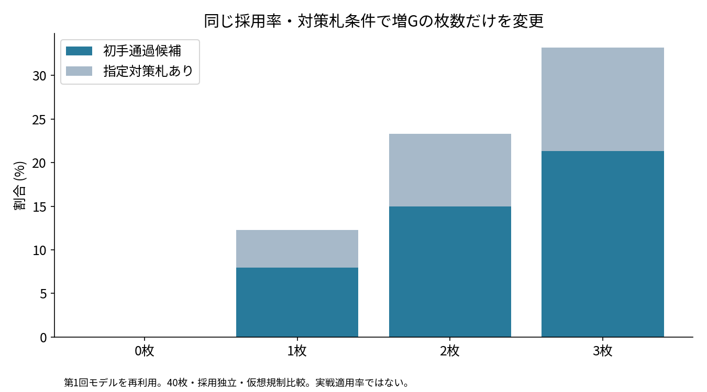
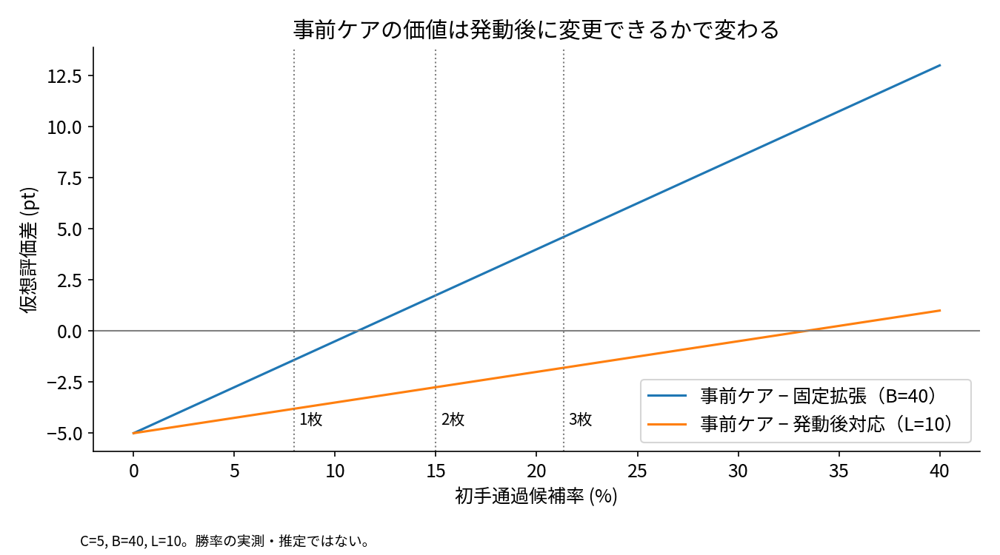
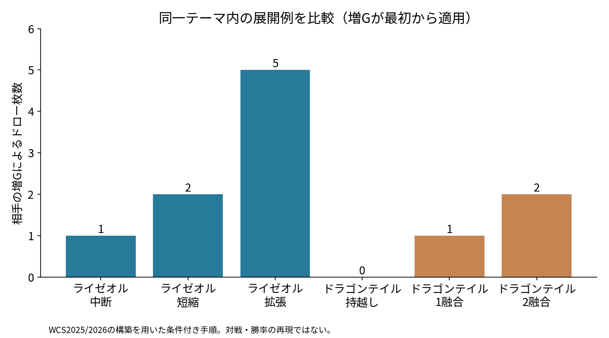

# 【遊戯王MD】増殖するGは存在するだけで先攻展開を抑止するのか――第2回・400万回の初手抽選と展開ルート比較

検証ノート｜2026年11月27日

## はじめに

増殖するG（以下、増G）の禁止に反対する理由として、引かなくても存在するだけで先攻の展開を抑える、という説明がある。第1回では、2026年11月5日の採用率を用いた40枚の基準モデルで、初手通過候補率が7.9521%となった。しかし、通過頻度の低さだけでは間接的な抑止力を否定できない。

本稿の目的は、抑止力が存在することと、その規模・規制枚数への依存・維持の必要性を分けて検証することである。増G禁止を支持する立場だが、禁止反対論に有利な条件も提示する。

第1回：[初手通過候補率の検証](https://github.com/kensho-note/masterduel-analysis/tree/main/maxx-c/01-opening-hand)

## 1. 抑止力の定義と検証の範囲

| 経路 | 内容 | 今回の評価 |
|---|---|---|
| 事前抑止 | 発動前に展開ルートを変更する | 戦略の成立条件を感度分析 |
| 直接抑止 | 増G適用後に展開を止める・縮小する | カード効果に基づく展開例 |
| 対策札消費 | 無効化にうらら・抹殺等を使わせる | 初手状態の頻度・仮想費用 |
| 構築への影響 | 展開ルート・デッキ採用札の変化 | 未測定 |

400万回の初手抽選は第1回のモデルを再利用し、0～3枚の各条件を100万回ずつ再実行した。さらに3,600条件の決定論的な戦略評価を行った。後者は対戦シミュレーションではない。実在構築から2テーマ6ルートを組み立てたが、実機のリプレイを再生したものではない。カードテキストに基づく条件付き手順であり、実際にその手順が選択された頻度は不明である。

## 2. 規制枚数と増Gの発生確率

第1回の2026年11月採用率モデルを固定し、増Gの採用者が0～3枚採用する仮想環境を比較した。増G採用率98.3%、うらら94.8%（採用者3枚）、抹殺41.1%（採用者1枚）、墓穴0枚、40枚。採用は独立、両者のデッキ抽選も独立。抹殺の宣言対象が残っている条件も判定する。採用率が規制変更後も同じという仮定であり、過去の実環境そのものではない。

| 増G枚数 | 初手保有 | 指定対策札あり・増G保有 | 初手通過候補（厳密） | 100万回の抽選 |
|---|---:|---:|---:|---:|
| 0 | 0% | 0% | 0% | 0% |
| 1 | 12.2875% | 4.3354% | 7.9521% | 7.9842% |
| 2 | 23.3147% | 8.3132% | 15.0016% | 15.0071% |
| 3 | 33.1812% | 11.8421% | 21.3392% | 21.3566% |

初手通過候補率を p、初手の増Gに対する指定対策札保有の同時確率を q とする。指定対策札を必ず適切に使用できる単純モデルであり、実際の適用率ではない。展開による追加ドロー、他の妨害、対策札の使用順序は含まれない。

先攻側は自分の初手を知っている。従って、平均的な p だけで事前ケアを判断するのは不適切である。対策札なしなら p=初手保有率、有効な対策札を必ず使えるなら p=0 とする両極端も分析した。1枚時はそれぞれ12.2875%、0%となる。

## 3. 事前ケアと発動後対応を比較する

先攻の戦略を次の3種類に分ける。

- A：拡張展開を固定し、増Gが通っても継続。
- B：増Gの発動前から短縮展開を選択。
- W：増Gが通らなければ拡張し、通ればその時点で短縮または継続のうち高評価の方を選ぶ。

通常時にBを選ぶ費用を C、増G適用時のBとAの評価差を B_gain、増G発動後に短縮することで事前短縮より失う評価を L、対策札使用の費用を K とする。いずれも仮想評価ポイントで、実測勝率ではない。勝率差として読む場合は各状態の勝率が0～100%の範囲にあることが別途必要。以下の式は通常時の拡張と適用時の事前短縮の共通項を各状態から差し引いた比較用スコアである。

E(A) = -p × B_gain - q × K

E(B) = -(1-p) × C - q × K

E(W) = -p × min(L, B_gain) - q × K

対策札消費は全戦略で等しく生じる場合だけ共通項として扱える。短縮展開に対して相手がGを発動しない場合などは q 自体が異なるため、本式の対象外である。

事前短縮が固定拡張以上になる閾値は C/(C+B_gain)、発動後対応以上になる閾値は C/(C+min(L,B_gain))。分母が0のときは全戦略が同点となる特殊ケースに注意する。

### 基準ケース

C=5、B_gain=40、L=10、K=5 と仮定した場合、固定拡張との閾値は11.11%、発動後対応との閾値は33.33%になる。

| 増G枚数 | p | 事前短縮−固定拡張 | 事前短縮−発動後対応 |
|---|---:|---:|---:|
| 0 | 0% | -5.00 | -5.00 |
| 1 | 7.95% | -1.42 | -3.81 |
| 2 | 15.00% | +1.75 | -2.75 |
| 3 | 21.34% | +4.60 | -1.80 |

元の禁止論では、固定拡張と事前ケアの比較で11.11%を損益分岐点とした。この計算は正しいが、発動後に変更できる戦略を除外した比較だった。今回、変更できる戦略を明示的に加えると、基準ケースでは3枚時代でも事前ケアより発動後対応の方が高評価になる。

逆に、発動後の変更が完全に無償であると仮定するのも不適切だ。すでに支払ったコスト、特殊召喚で与えたドロー、召喚制限、使用済み効果などは巻き戻せない。その費用 L を変化させて検討する。

### 反対派に有利な条件も検討する

1枚時、C=1、B_gain=40、L=20 なら閾値は4.76%となり、p=7.95%でも事前ケアが有利である。事前短縮の費用がほぼないなら、増Gの規制枚数が少なくてもケアする合理性は残る。

またC=5、B_gain=40、L=40なら閾値11.11%。平均p=7.95%では届かないが、対策札を持たないことが分かっている先攻のp=12.29%なら事前ケアが有利となる。

反対に L=0 なら、発動後対応は事前短縮以上となる（C>=0）。Gが通らなかった場合には拡張でき、通った場合には同じ短縮が選べるからである。

全3,600条件のグリッドは C=0/1/3/5/10、B_gain=10/20/40/60、L=0/5/10/20/40、K=0/5/10、0～3枚、初手情報3条件の直積である。この条件集合の割合を実戦における戦略の頻度とは解釈しない。

### 各WCSの構築条件による確認

第1回の厳密計算を使い、同じC=5、B_gain=40、L=10を当てはめた。年度別の実在構築モデルは11件の等重みサンプルであり、全大会の対戦比率ではない。

| 年度・規制 | 規制上限モデル p | 実在構築モデル p | 事前短縮−固定拡張（実在構築） | 事前短縮−発動後対応（実在構築） |
|---|---:|---:|---:|---:|
| 2023・3枚 | 14.28% | 22.36% | +5.06 | -1.65 |
| 2024・3枚 | 14.28% | 15.47% | +1.96 | -2.68 |
| 2025・2枚 | 10.05% | 11.12% | +0.00 | -3.33 |
| 2026・1枚 | 6.28% | 7.24% | -1.74 | -3.91 |

WCS2026の全ターン適用試合率8.76%などの観測値は、事前の発生確率と定義が異なるため、本式の p に直接代入しない。年度別の環境変化を増Gだけに帰属させることもできない。

## 4. 実在デッキの展開例

カード枚数と効果はKONAMI公式カードDBに掲載されたWCSのデッキレシピで確認した。以下は大会当時の構築に含まれるカードで作った例示ルートであり、現在のランク戦で当時と同じ構築が合法であることや、優勝者が実際にこの手順を採用したことを意味しない。通常召喚を増Gのドローに数えず、特殊召喚のイベントを数える。最適解を網羅していない。他の妨害は無いものとする。

### 4-1. ライゼオル（WCS2025 優勝 Mist）

40枚、増G2枚の公開構築を参照。初手にIce Ryzeal、デッキにSword・Ext・Node・Crossが残っている場合を考える。

共通部分：Iceを通常召喚し、効果でSwordをデッキから特殊召喚。SwordでExtをサーチする。Iceの効果に増Gをチェーンされた場合、効果がそのまま解決すればSwordの特殊召喚により最低1ドローが生じる。

| 戦略 | 手順 | 最初から増G適用時のドロー | 到達状態 |
|---|---|---:|---|
| 中断 | 共通部分で停止 | 1 | Ice、Sword、手札Ext |
| 短縮 | IceとSwordでDetonatorをX召喚 | 2 | Detonator素材2、手札Ext |
| 拡張 | Extを自己SS（予備Detonatorを墓地へ）→IceとSwordでDuo Drive、墓地Detonatorを素材化→IceとSwordを外しNode・Crossをサーチ→Node自己SS→ExtとNodeでDetonator、墓地素材を追加→Cross発動 | 5 | Duo Drive、Detonator、Cross |

短縮でもDetonatorの破壊・破壊代替の選択肢を確保できる。拡張ではCrossによるモンスター効果の無効化が追加され、素材の使い方も変わる。これらは発動条件や相手の行動に依存し、独立の確定妨害回数とはみなさない。

増Gが適用された試合で拡張から短縮へ変更すれば、相手に与えるドローを5枚から2枚へ、3枚減らせる。反面Crossなどのリソースは失う。これが直接抑止の具体的な例である。発動前に短縮を決めるべきかは、失う盤面価値と発動後の変更可能性に依存する。公開された別のライゼオル構築の解説にも、増Gを受けてDetonator等で停止するというプレイ方針が見られる（下記資料）。

### 4-2. 烙印ドラゴンテイル（WCS2026 優勝 CER.subaduck）

40枚、増G1枚の公開構築を参照。MululuとUrgulaが初手にあり、Horn・Flameがデッキに残る条件。

| 戦略 | 手順 | 最初から増G適用時のドロー | 到達状態 |
|---|---|---:|---|
| 持越し | Mululuを通常召喚してターン終了 | 0 | 相手メインフェイズにUrgulaと融合する選択肢 |
| 1融合 | Mululuの効果で自身と手札Urgulaを素材にGulamelを融合。素材の効果でHornとFlameをセット | 1 | Gulamel、伏せ2枚 |
| 2融合（追加条件） | 1融合に加え、手札Rahuと別のモンスター、デッキのPan・Stingがある場合、Rahuで手札モンスターとデッキPanを素材にArthalionを融合し、PanでStingをセット | 2 | Gulamel、Arthalion、伏せ3枚 |

2融合の追加条件を満たす初手では3戦略とも選択できる。初手に必要カードが揃う割合は今回未測定であり、代表的な手札だとは主張しない。

持越しは先攻ターンの特殊召喚を0回にできるが、相手ターンの融合が成立する保証はない。Mululuによるモンスター効果無効等は条件付きで、そこでセットした通常罠は原則そのターンに使用できない。1融合では罠を相手ターンに使う準備ができ、Gulamelの効果も狙える。増Gに対して低いドロー枚数で動けることと、盤面の強さが等しいことは別である。

増Gの効果は解決後の特殊召喚から適用される。例えば既に1回の特殊召喚が済んでから解決した場合、拡張ライゼオルでは残り4回、短縮では残り1回がドロー対象となる。ただしそのタイミングでルートの変更が可能かは別の問題である。`timing.csv` は残り回数の計算であって、すべてのタイミングで発動可能だと保証するものではない。

## 5. 追加ドローによる誘発候補の取得

WCS2025 Mistの40枚構築には、うらら3、ヴェーラー1、無限泡影1が含まれる。ここではこの5枚のみを「妨害候補」とする。増G2枚のうち1枚以上が初手にあることを条件に、初手の他カードと追加ドローを超幾何分布で厳密計算した。ニビルやドロールは発動条件が異なるため、この集合から除外した。候補取得と実際に妨害できることは同じではない。

| 追加ドロー | 追加分に候補1枚以上 | 初手に候補ゼロかつ追加分に候補1枚以上 |
|---|---:|---:|
| 1 | 12.80% | 7.99% |
| 2 | 24.26% | 15.04% |
| 3 | 34.48% | 21.24% |
| 4 | 43.57% | 26.66% |
| 5 | 51.61% | 31.38% |

5枚を引く予定が2枚に減れば、追加分に候補を得る確率は27.36ポイント下がる（他の条件固定）。これは増Gを受けて止まることが合理的になり得る根拠でもあり、追加ドローの連鎖が生じ得ることの根拠でもある。ただし、手札誘発が実際に使われれば展開が途中で終了する可能性もあるため、5枚まで引き続けられると固定したモデルである。先攻側がライゼオルであることと、後攻側にこの構築を置くことは独立した例示である。

## 6. 対策札を消費させる価値

増Gが初手にあり、かつ指定3種の対策札が先攻初手にある確率qは、現行基準モデルで4.3354%である。対策札を使わせるだけでも後続誘発や返しのターンに影響し得るという反対派の指摘には合理性がある。

仮にその状態すべてで増Gを発動して対策札を消費させ、平均で後攻勝率が5pt改善すると仮定すれば、全試合換算で0.217ptとなる。10ptなら0.434pt、20ptなら0.867pt。これは純利益の推定値ではない。実際には増G自体を失うコスト、他の誘発を引いているか、先攻が同じ札を別に使用したか、別ターンに使用したかで効果は変わる。対策札を使わせた割合も実測していない。

また、増Gが通ったことで展開が縮小する利益は適用試合の勝率差に含まれ得る。元記事の加重観測勝率差に直接抑止を追加計上すると二重計上する危険がある。事前抑止や対策札消費も識別するには独立した比較が必要である。

## 7. 禁止反対論の検証結果

| 主張 | 判定 |
|---|---|
| 増Gが通れば展開を縮小する動機がある | 支持。実在構築においてドローを抑える短縮例が成立する |
| 増Gの存在だけで事前ケアするべき | 条件付き。発動後変更の費用、事前ケアの費用、自分の対策札で変わる |
| 3枚時代と同じ事前抑止力が1枚でもある | 根拠不足。同じ費用なら発生確率が下がることで事前ケアの相対価値は低下する |
| 1枚では事前抑止力が全くない | 誤り。低費用ケアや発動後に変更できないケースでは成立する |
| うらら等を使わせるだけでも意味がある | 妥当な仕組み。実測の純利益は不明 |
| 抑止力がある以上禁止すべきではない | 抑止の存在から維持の不可欠性は導けない。他の規制案との比較が必要 |

反対派に求めるデータは、同一初手・同一盤面条件で増Gの存在を知る場合と知らない場合の選択の差、発動タイミング別の短縮率、無効化後に残る誘発、テーマ別の盤面と勝率である。禁止賛成派にも同様の証拠が求められる。

## 8. 結論

増Gの抑止力は存在し得る。実際に展開を縮小する合理的な理由も説明できる。これを否定する必要はない。

しかし、増Gが引かれなくても同じ規模の抑止力を持ち続けるという説明には根拠が不足している。特に、発動後のルート変更が可能なデッキでは、事前ケアの価値を固定ルートとの比較だけで評価することはできない。一方、初手に対策札がなく、事前ケアが低費用なら1枚でも警戒の利益が残る。

増Gが通って初めて縮小される過剰な展開を、増Gが通らない多数の試合で許容する環境が適切なのか。過剰な先攻展開の規制を、特定の制限カードを引くことに委ねるより、展開能力そのものへの規制を検討すべきである。私は先攻制圧への規制と後攻支援の拡充を伴う増G禁止を支持する。

今回の結果は、禁止後の勝率改善や実戦での抑止規模を証明していない。次にマルチャミーによる代替を検証する際は、召喚元・発動条件・ドローの持越し・重複適用を評価する。

## 参考資料・追試

- [第1回の公開コードとデータ](https://github.com/kensho-note/masterduel-analysis/tree/main/maxx-c/01-opening-hand)
- [KONAMI公式カードDB：増殖するG](https://www.db.yugioh-card.com/yugiohdb/card_search.action?cid=9455&ope=2&request_locale=en)
- [WCS2025 Mist ライゼオル：公式構築とカードテキスト](https://www.db.yugioh-card.com/yugiohdb/member_deck.action?cgid=951b1e71a6a30f01ee6f025086d06941&dno=92&request_locale=en)
- [WCS2026 CER.subaduck 烙印ドラゴンテイル：公式構築とカードテキスト](https://www.db.yugioh-card.com/yugiohdb/member_deck.action?cgid=951b1e71a6a30f01ee6f025086d06941&dno=141&request_locale=en)
- [Master Duel Meta：Moleのライゼオル構築解説（2025年8月）](https://www.masterduelmeta.com/top-decks/master-v/august-2025/ryzeal/mole/Sr5s3)（プレイヤーの見解。WCSの行動頻度ではない）
- [2026年11月5日採用率（Master Duel Meta転載）](https://mdm.app.duellinksmeta.com/articles/news/november-05-2026/card-usage-update)

データ・実行方法・モデルの詳細は同梱README.mdに記載。外部データの利用条件は公開前に確認すること。
