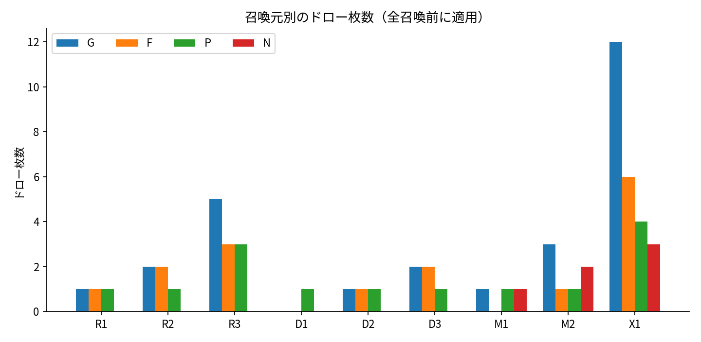
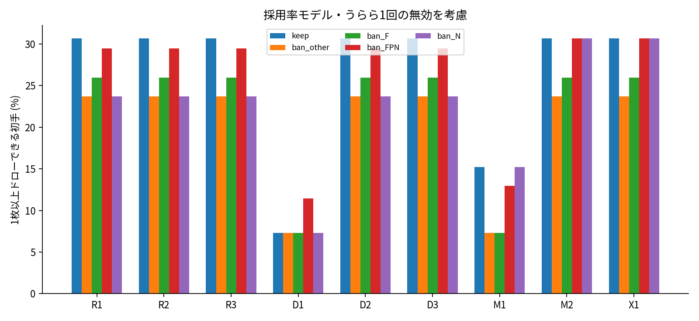
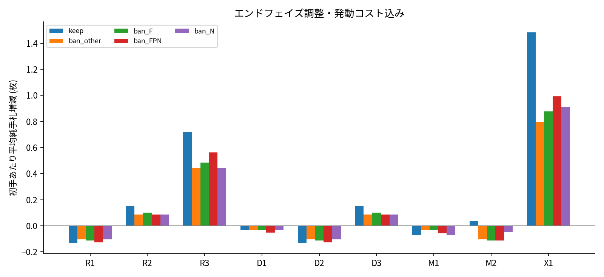

# 【遊戯王MD】マルチャミーは増殖するGの代替になれるのか――第3回・600万回の初手抽選と召喚元別比較

検証ノート｜2026年11月27日

## はじめに

《増殖するG》（以下、増G）の禁止に反対する理由の一つに、マルチャミーは増Gより弱く、後攻救済を代替できないという主張がある。前回までの検証では、増Gの初手通過候補率と、発動前後の展開変更の合理性を検討した。

今回は、カード単体の強さ、初手からの利用機会、追加ドローによる手札増加を分けて比較する。結論を先に述べると、マルチャミーへの単純置換によって初手保有率を回復できる場合はあるが、増Gと同等の手札増加まで回復できるとは限らない。一方、増Gでドローできない通常召喚に対応できるなど、マルチャミー固有の利点も存在する。

増G禁止と先攻制圧の調整を支持する立場だが、代替策として十分かどうかは検証結果に基づいて判断する。

## 1. 検証条件と評価指標

3,888条件の基本比較に、1,944条件の純手札増加を最適化する戦略を追加し、計5,832条件を厳密計算した。基準の採用率モデルについて6種類の構築方針を100万回ずつ、合計600万回の独立した初手状態の抽選で照合した。同じ抽選を9ルートに再利用したため、54条件分の結果がある。初手の当たり方を多項分布で抽選する方式であり、デュエルそのものを再現したものではない。ドロー機会率の厳密計算との最大差は0.111ポイントだった。

| 指標 | 定義 |
|---|---|
| 初手保有率 | ドロー系誘発を1枚以上持つ確率。召喚元は問わない |
| ドロー機会率 | 固定ルートと発動戦略の下で、1枚以上追加ドローする初手の確率 |
| 純手札増加率 | エンドフェイズ調整後に手札が初手5枚より多い確率 |
| 平均純手札増減 | 5枚との差を全初手で平均。無効化されたカードの消費も含む |

これらは勝率ではない。盤面突破のために十分な手札が得られるかは、カードの種類とプレイヤーの判断に依存する。

## 2. ドロー系誘発の設計比較

| 項目 | 増G | フワロス | プルリア | ニャルス |
|---|---|---|---|---|
| 通常召喚（手札） | × | × | ○ | × |
| 手札から特殊召喚 | ○ | × | ○ | × |
| デッキ・EXから特殊召喚 | ○ | ○ | × | × |
| 墓地・除外から特殊召喚 | ○ | × | × | ○ |
| 自分フィールドにカードがある場合 | 発動可能 | 発動不可 | 発動不可 | 発動不可 |
| エンドフェイズの手札調整 | なし | あり | あり | あり |

同時に複数体が特殊召喚された場合も、1回の召喚イベントに対して1枚ドローする。マルチャミーは同名を含め合計2回まで発動可能で、増Gも別に1回使用できる。うららは1ターンに1回のみ。全カードは召喚前に発動し、発動コストとして手札から1枚減るものとする。

マルチャミーの手札調整はドロー枚数自体を制限するのではない。適用されたターンのエンドフェイズに、相手のフィールドのカード数+6を超える手札を無作為にデッキへ戻す。その前に引いた誘発を使うことはできる。複数適用されても、他の処理のない今回の条件では同じ手札上限となる。増Gと同時適用した場合も、マルチャミー側の手札調整の影響を受ける。

## 3. 実在テーマの召喚元を比較する

第2回のライゼオル・烙印ドラゴンテイルの6ルートを再利用し、WCS2025のLuka選手のM∀LICE構築から、除外・墓地を使う2つの部分ルートを追加した。さらに手札調整の効果を見るため、12回特殊召喚の仮想例を設けた。

いずれも公式構築を基にした条件付きの例であり、大会リプレイや現環境の代表的展開を測定したものではない。M∀LICEの例は、ドーマウスの通常召喚→ホワイトラビットをデッキから除外→除外から自己特殊召喚→罠セット、さらに2体でスプラッシュ・メイジをリンク召喚してドーマウスを墓地から蘇生するところまでで止める。完成盤面ではない。除外元がデッキであっても、特殊召喚元は除外である。

| ID | 展開 | 増G | フワロス | プルリア | ニャルス |
|---|---|---:|---:|---:|---:|
| R1 | ライゼオル・中断 | 1 | 1 | 1 | 0 |
| R2 | ライゼオル・短縮 | 2 | 2 | 1 | 0 |
| R3 | ライゼオル・拡張 | 5 | 3 | 3 | 0 |
| D1 | ドラゴンテイル・通常召喚して終了 | 0 | 0 | 1 | 0 |
| D2 | ドラゴンテイル・1融合 | 1 | 1 | 1 | 0 |
| D3 | ドラゴンテイル・2融合 | 2 | 2 | 1 | 0 |
| M1 | M∀LICE・初動 | 1 | 0 | 1 | 1 |
| M2 | M∀LICE・リンク2＋蘇生 | 3 | 1 | 1 | 2 |
| X1 | 仮想・長い展開 | 12 | 6 | 4 | 3 |

R3では増G5枚に対しフワロスは3枚。M2ではニャルスがフワロスを上回る。D1ではプルリアにだけドロー機会があるが、発動コストを含めれば1枚引いても手札は増えない。カード単体の優劣は一律ではない。

発動タイミングも重要である。R3で通常召喚後にプルリアを発動すれば3枚ではなく2枚となる。Swordの特殊召喚後にフワロスを発動すれば3枚ではなく2枚となる。このような途中発動を全ルートで抽選してはいないため、表は早期発動の条件付き潜在値である。

## 4. 既にフワロスを3枚採用していたらどうなるか

11月5日時点の最高ランク帯の公開採用率（増G98.3%、フワロス71.7%、プルリア30.2%）を使用する。ニャルスの採用率は確認できなかったため、基準値を0%とし、20%、50%の仮定も比較する。採用者のマルチャミー枚数は1、2、3枚の場合を個別に計算し、各カードの採用は独立と仮定する。実際の同時採用や採用枚数の分布ではない。各デッキ40枚を保つため、抜いた枠は他のカードで補う。各マルチャミーの上限は3枚と置く。

| 構築方針 | 基準モデルの初手保有率 |
|---|---:|
| 増G維持 | 41.18% |
| 禁止・他のカードに置換 | 32.27% |
| 禁止・フワロスのみ追加（空きがある場合） | 35.45% |
| 禁止・フワロス→プルリア→ニャルスの順で空き枠へ補充 | 41.18% |
| 禁止・ニャルスのみ追加（空きがある場合） | 41.18% |

基準モデルは採用者が各マルチャミーを3枚採用する条件である。増Gの禁止による保有率の低下は8.91pt。フワロスだけでは3.18ptしか補えない。一方、他のマルチャミーに置き換えればドロー系誘発の総枚数は保たれるため、初手保有率を回復できる。対応範囲は異なるので、この一致は代替成功の証明ではない。

実在のWCS構築でも確認する。

| 後攻側の構築 | 増G/F/P/N | 維持 | 禁止・他札 | Fのみ追加 | F→P→N |
|---|---|---:|---:|---:|---:|
| WCS2025 Mist ライゼオル | 2/3/2/0 | 63.93% | 50.66% | 50.66% | 63.93% |
| WCS2025 Luka M∀LICE | 2/0/0/0 | 23.72% | 0% | 23.72% | 23.72% |
| WCS2026 subaduck 烙印ドラゴンテイル | 1/3/1/0 | 50.66% | 42.71% | 42.71% | 50.66% |

各年度の増G上限（2025年2枚、2026年1枚）を反映した実採用数である。置換は当時の大会共有枠等を再現するものではなく、3枚上限の反実仮想。フワロス3枚のデッキでは、増Gの枠をフワロスで埋めることはできないという反対派の主張は正しい。ただし別のカードへの置換は可能である。

## 5. 初手保有率と実際のドロー機会は別である

うららの採用率94.8%、採用者3枚、40枚と仮定すると初手保有確率は32.00%。これを「指定したドロー系誘発を1回無効化する確率」とした感度分析を行った。先攻はそのルートで最多のドローを与える効果を無効にする。抹殺、墓穴、ドロール、発動順、他の誘発へのうらら使用、後攻が追加ドローから得た効果の発動などは省略する。対策なしと1回必ず無効にする条件もCSVに収録した。第1回の増G単独の7.95%モデルとは条件が異なる。

まず、引いた誘発のうち1枚以上のドローが見込まれる増Gと最大2枚のマルチャミーを発動する積極戦略を設定した。同名2枚も許容し、2枚目の発動で最初の無効を突破できる場合がある。一方、無効が予想されても発動するという仮定であり、合理的に温存する選択は後述する。

| 固定展開 | 増G維持 | 禁止・他札 | Fのみ追加 | F→P→N |
|---|---:|---:|---:|---:|
| ライゼオル・拡張 R3 | 30.69% | 23.70% | 25.95% | 29.46% |
| ドラゴンテイル・通常召喚 D1 | 7.28% | 7.28% | 7.28% | 11.47% |
| ドラゴンテイル・2融合 D3 | 30.69% | 23.70% | 25.95% | 29.46% |
| M∀LICE・リンク2＋蘇生 M2 | 30.69% | 23.70% | 25.95% | 30.69% |
| 仮想長展開 X1 | 30.69% | 23.70% | 25.95% | 30.69% |

保有率が回復しても、対応できない召喚があるとドロー機会は完全には回復しない。逆にM2・X1では、置換方針によって機会率が一致する。D1はプルリアの追加によって機会率が高まる。ただしドロー機会の確保だけでは手札が増えたことにはならない。

## 6. 発動コストと手札調整まで含める

純手札増減は、初手5枚から発動したカードを引き、実際に通ったドローを加え、マルチャミーが適用された場合は手札上限を適用した後の差とする。他カードの消費やサーチは含めない。

| 固定展開 | 増G維持 | 禁止・他札 | Fのみ追加 | F→P→N |
|---|---:|---:|---:|---:|
| R3 | +0.720枚 | +0.445枚 | +0.484枚 | +0.562枚 |
| D1 | −0.033枚 | −0.033枚 | −0.033枚 | −0.052枚 |
| D3 | +0.150枚 | +0.087枚 | +0.101枚 | +0.087枚 |
| M2 | +0.035枚 | −0.103枚 | −0.113枚 | −0.114枚 |
| X1 | +1.482枚 | +0.795枚 | +0.876枚 | +0.991枚 |

R3では置換後もドロー機会率は維持に近いが、純増は0.720枚から0.562枚へ低下する。X1では同じドロー機会率にもかかわらず純増が0.491枚減る。増Gの効果を完全に置き換えられないという反対派の指摘には数値的な根拠がある。

一方、長展開X1の単独発動を比べると、増Gは12枚引いて手札16枚（純増11枚）、フワロスは6枚引いて手札10枚から9枚に調整（純増4枚）。フワロス2枚が通れば12枚引けるが、手札15枚から9枚になる。追加誘発を途中で使える機会は残る。増Gの過剰な手札持ち越しを再現しないという設計上の差は明確である。これはカードの設計比較であり、手札差がどれほど勝率差になるかは別途検証を要する。

### 発動しない戦略も評価する

不利益のある誘発を機械的に発動する戦略だけでは、マルチャミーを過小評価し得る。そこで全ての合法な発動枚数を比較し、既知の固定ルートと無効確率の下でエンドフェイズ後の期待純手札増加を最大化する戦略を加えた（同点の場合はドロー枚数が多い方、次に発動枚数が少ない方）。相手の初手は知らないが、展開ルートを知るという理想化を置く。

| 固定展開 | 維持・最適化 | 禁止・F→P→N | 禁止・N追加 |
|---|---:|---:|---:|
| R3 | +0.720枚 | +0.562枚 | +0.445枚 |
| D1 | 0枚 | 0枚 | 0枚 |
| M2 | +0.128枚 | +0.010枚 | +0.044枚 |
| X1 | +1.594枚 | +0.991枚 | +0.912枚 |

温存を許せば負の期待純増を回避できる。M2ではニャルスを優先して増やした方がF→P→Nよりも良い。相手テーマごとに適切なカードが異なるため、BO1では構築上のトレードオフが生じる。ただしこの戦略は純手札枚数だけを目的とし、抑止力や対策札消費の価値、引いたカードの質は評価しない。

### 追加ドローから妨害候補を得る確率

残り35枚のデッキに候補が5枚または8枚残っていると固定すると、k枚の追加ドローから1枚以上を得る確率は 1 − C(35−候補数,k)/C(35,k)。候補5枚の例ではR3で3枚ドローなら37.97%、5枚なら56.10%。増Gとマルチャミーの差はこの段階でも残る。正確な値は `candidate_draws.csv` を参照。実際には候補の残数や発動可否が異なるため、取得率は妨害成功率ではない。

## 7. 大会統計と照合する

| 大会 | 増G上限 | 増G非適用→適用の後攻勝率 | マルチャミー非適用→適用の後攻勝率 |
|---|---:|---|---|
| WCS2025 | 2枚 | 27.03% → 47.62% | 30.14% → 37.84% |
| WCS2026 | 1枚 | 32.00% → 62.50% | 32.90% → 44.19% |

2025年はPrismachete氏の集計（増Gは記事掲載の補正値）、2026年はアプカ氏の集計を用いた。WCS2026ではマルチャミー群の勝率差の検定はp=0.153と報告され、有意差は確認されていない。増Gの勝率差がより大きいことは観測上の事実だが、発動・適用する状況、採用枚数、対面、効果の重複が異なるため、カード単体の因果効果ではない。両カードが通った試合もあり得るため、この勝率差を足すこともできない。

今回の固定展開モデルと大会観測値は違う指標であり、勝率差をシミュレーターの正解値として使用していない。環境全体の後攻勝率を予測するには、展開ルートの実際の頻度と、手札増減と勝率の関係を測定する必要がある。

## 8. 結論――代替カードと代替政策を区別する

禁止反対派の「マルチャミーは増Gより対応範囲が狭い」「既にフワロスを3枚採用している場合に補充できない」という主張は、公式テキストと実在構築によって裏付けられる。単純な置換で手札獲得力を完全に回復できないことも、今回のモデルでは確認できた。

しかし、これをもって増Gの禁止が不可能だという結論にはならない。増Gの12ドローや完成盤面からの発動をそのまま再現することが後攻救済の目的ではないからだ。必要なのは反撃するための行動機会であり、マルチャミーの召喚元分割・先攻盤面からの発動制限・過剰ドローの持ち越し制限は、そのための設計として評価すべき点である。

他の手札誘発、捲り札、先攻制圧への追加規制を含む政策として、増Gの機能を複数の手段で代替することを提案する。その十分性は未検証であり、今回の結果から勝率の維持までは断言できない。増G単独禁止を正当化する証拠でもない。

**増Gと同じドロー枚数を確保できないという事実と、増Gを残さなければ後攻救済が成立しないという結論は別である。** 反対派には後者を支持する比較データを求めたい。同時に、禁止賛成派としても代替政策が実際に機能する条件を具体的に検証していく必要がある。

## 参考資料・再現方法

- [第1回の公開コード・データ](https://github.com/kensho-note/masterduel-analysis/tree/main/maxx-c/01-opening-hand)
- 第2回「先攻展開に対する抑止力」：前稿の6展開例を `routes.csv` に再掲。
- [KONAMI公式カードDB：増G](https://www.db.yugioh-card.com/yugiohdb/card_search.action?cid=9455&ope=2&request_locale=en)
- [フワロス](https://www.db.yugioh-card.com/yugiohdb/card_search.action?cid=20500&ope=2&request_locale=en)／[プルリア](https://www.db.yugioh-card.com/yugiohdb/card_search.action?cid=20206&ope=2&request_locale=en)／[ニャルス](https://www.db.yugioh-card.com/yugiohdb/card_search.action?cid=20764&ope=2&request_locale=en)
- WCS公式構築3件：個別URLは `deck_profiles.csv` を参照。
- [2026年11月5日採用率（Master Duel Meta転載）](https://mdm.app.duellinksmeta.com/articles/news/november-05-2026/card-usage-update)
- [WCS2025統計（Prismachete氏）](https://www.masterduelmeta.com/articles/tournaments/maxxc-WCS2025)
- [WCS2026統計（アプカ氏）](https://note.com/apkallone/n/n9ccd39b48ff5)

本稿は非公式の検証であり、全試合の独立再集計や実機での展開確認は行っていない。コード・入力条件・結果を併せて公開する予定である。
