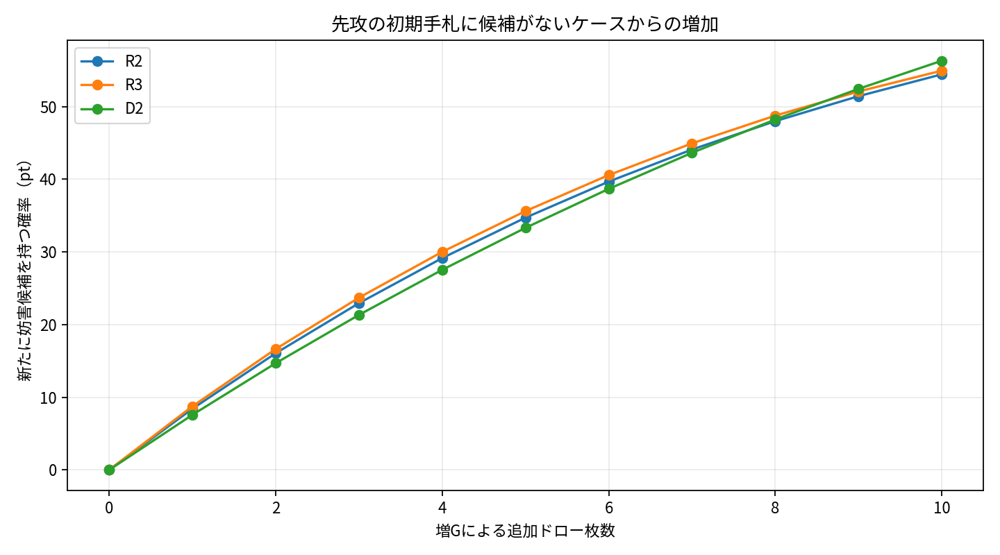

# 第4回 — 先攻増Gと盤面突破

検証日：2026-11-27。先攻盤面を固定した条件付き比較。WCS2025のMist（ライゼオル）2盤面、WCS2026のCER.subaduck（烙印ドラゴンテイル）1盤面を、第2・3回の展開例から引き継ぎます。実機対戦・勝率予測は行っていません。

[記事全文](article.md)



## 実行

Python 3.11以上。NumPy 2.3.5、Matplotlib 3.10.8で検証。日本語グラフは Noto Sans CJK JP 推奨（非同梱）。

```sh
cd maxx-c/04-going-first
python -m pip install -r requirements.txt
python simulate.py --trials 1000000
```

乱数シード2026112704。各3盤面×3候補群に100万回ずつ抽選（900万系列、候補群は独立抽選）。同一系列の0〜10ドローを再利用します。100万回の実戦ではありません。出力CSV・PNGは上書きされます。動作確認は `--trials 10000`。

## ファイル

- `profiles.csv`：公式WCS構築に基づくカード枚数と固定条件。固定の初手には増G（比較群は候補でない1枚）と展開に必要な指定カードを含める。`fixed_deck` は先攻展開でデッキから取り出した指定カード。
- `gates.csv`：後攻ライゼオルの行動と妨害の発動条件。歴史的な構築のカード効果を比較する例で、異年度構築同士の大会合法性や現行ランク戦での成立は保証しない。
- `results.csv`：99行。3盤面×3候補群×11ドロー枚数。`baseline` は未使用の妨害候補を初期の未知手札に1枚以上保有、`with_g` は追加ドロー込み、`increment` は初期に候補がなく追加で初めて取得、`increment_given_no_held` は初期に候補なしを条件とした取得率、`draw_any` は初期保有の有無を問わない追加ドローでの取得率。`mc_*` は乱数推定。確率は0〜1。
- `checkpoints.csv`：4種類のタイミングを抽出。D2でヴェーラー・ニビルは元構築にないため数えない。
- `sensitivity.csv`：2,112行。`gate_relevance_assumed` は取得した候補が実際に妨害として機能する条件付き確率の仮定。`proxy_increment` は追加取得率×この仮定。勝率や盤面突破率ではない。
- `run_log.txt`：実行ログ。`simulate.py`：厳密計算・乱数抽選・グラフ生成。PNG3点。

## 制約

固定した指定カード（物理的な1枚ずつ）を除いた残りのカードを無作為に配る条件モデル。実際の初手で任意の同名カードを引いた条件の分布とは異なる。初期手札の候補消費、対策札、盤面の発動順、展開の中断、追加のサーチやシャッフル、複数の候補群の同時成立、勝敗は再現しない。各チェックポイントは独立の反実仮想であり、前の妨害を実行したうえで後の展開が必ず続くという意味ではない。ドロールの使用は自分の増Gの追加ドローも止める。ニビルは自分の盤面もリリースし得る。無限泡影・マルチャミーは自分の場にカードが残る条件では手札発動できないため除外。先攻増Gの保有率・通過率を条件に掛け合わせた実戦値ではない。

出典は article.md と profiles.csv。非公式の個人検証。外部データの利用条件は各出典を参照。
