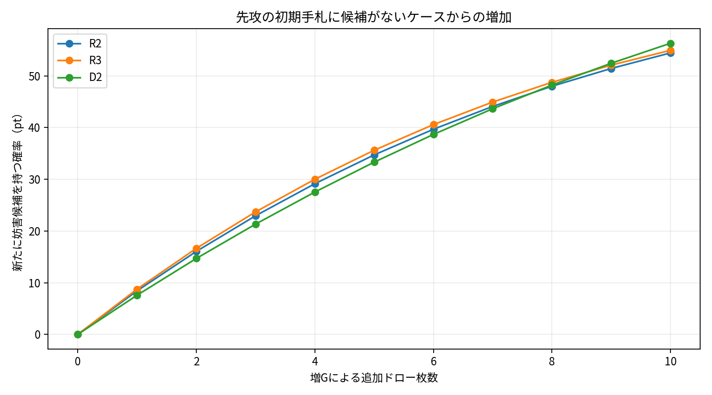
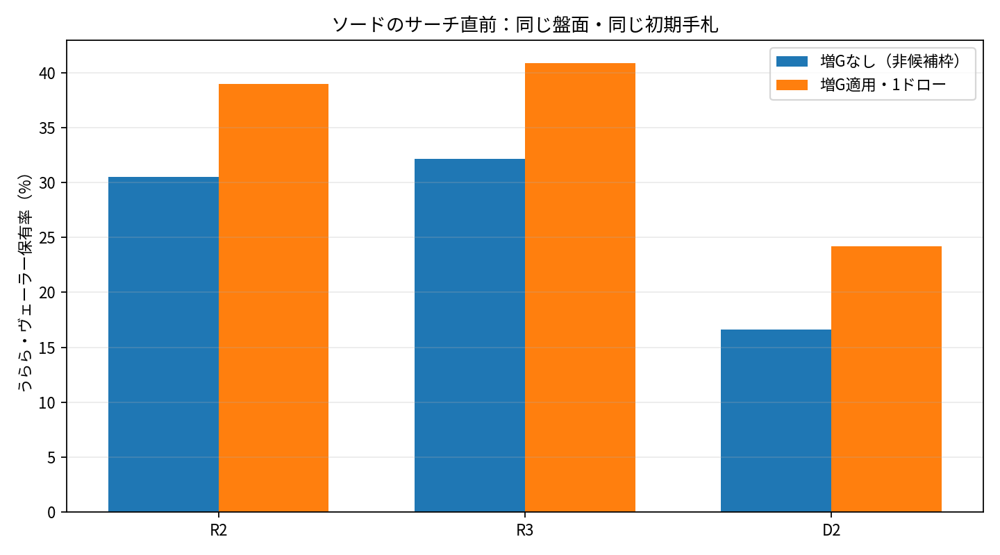
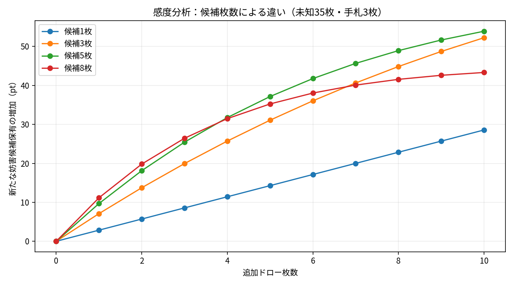

# 【遊戯王MD・検証第4回】先攻増Gは後攻の盤面突破をどれほど阻害するのか

検証ノート／2026年11月27日

## はじめに

《増殖するG》の維持を支持する理由として、先攻有利な遊戯王における後攻救済が挙げられる。しかし増Gは、完成した先攻盤面を持つ側からも使用できる。後攻を救済する能力と、先攻盤面を補強する能力を区別しなければ、このカードの設計を適切に評価できない。

前稿では、先攻増Gの実害を勝率だけでは評価できない可能性を指摘した。本稿は第2回の展開例、第3回のカード設計の比較を引き継ぎ、同一盤面・同一の初期リソースで増Gの追加ドローが後攻の行動にどのような影響を与え得るのか検証する。結論ありきではなく、増Gの代わりに通常の妨害札を持つ場合も比較する。

## 1. 反対派の根拠：先攻増Gは勝率を上げていないのではないか

| WCS | 増G上限 | 先攻増G非適用時勝率 | 適用時勝率 | 差 |
|---|---:|---:|---:|---:|
| 2023 | 3枚 | 54.5% | 65.6% | +11.1pt |
| 2024 | 3枚 | 59.8% | 62.5% | +2.7pt |
| 2025 | 2枚 | 71.70% | 61.54% | −10.16pt |
| 2026 | 1枚 | 66.12% | 59.38% | −6.74pt |

2023〜2025は前稿の集計を引用（年度ごとの補正条件は完全には統一されていない）。2026はアプカ氏の集計を再確認した。2026年は274試合、先攻増G適用32試合19勝、非適用242試合160勝、後攻増G適用24試合15勝、非適用250試合80勝。先攻側の差は有意ではない（p=0.451、集計者の検定）。先攻増G適用群の勝率の95% Wilson区間は42.3〜74.5%。

**先攻増Gが先攻勝率を押し上げていると断定する根拠はない。** 反対派のこの指摘は妥当である。逆に増Gが先攻に不利益をもたらすと断定することもできない。先攻増G適用32試合は全ターンの集計であり、完成盤面からの発動32試合ではない。

後攻救済の観点からは、先攻側の適用率11.68%が後攻側の8.76%を上回る事実も無視できない。少なくとも先攻での使用は現実に観測されている。ただし適用回数の差に有意性があるか、同一試合内の重複を含めた比較までは行っていない。

## 2. 固定盤面と比較条件

第2・3回の公式デッキレシピと展開例に基づき、以下の3盤面を選んだ。大会リプレイではなく、指定カードが利用可能で、展開が成功した条件の例である。

| ID | 先攻構築 | 盤面 | 固定した初手 | デッキから取り出す固定札 | 未知手札 | 残りデッキ |
|---|---|---|---|---|---:|---:|
| R2 | WCS2025 Mist・ライゼオル | デッドネーダー | 増G・アイス | ソード・エクス | 3 | 33 |
| R3 | 同上 | デッドネーダー・デュオドライブ・クロス | 増G・アイス | ソード・エクス・ノード・クロス | 3 | 31 |
| D2 | WCS2026 CER.subaduck・烙印ドラゴンテイル | ガルメラ＋伏せ罠2枚 | 増G・ムルル・ウルグラ | 融合素材効果でセットする罠2枚 | 2 | 33 |

40枚デッキ。初手にある指定カードと展開で取り出す指定カードは物理的な個体を固定する。残りの未知プールはR2=36枚、R3=34枚、D2=35枚。実際に同名カードのいずれかが初手にあることを条件とした母集団とは異なる。

先攻が所持している増Gを発動して効果が通ったケースと、同じ枠に今回の妨害候補でないカードがある（または増Gが通らず追加ドローが生じない）ケースを比較する。未知手札と残りデッキの順序は共通にする。先攻盤面の妨害は固定し、他の手札の消費、後攻側の対策札、増G無効化に伴うカード消費はここでは変化させない。

先攻側の40枚リストは各年度の規制上限（2025年2枚、2026年1枚）に従う。一方、本検証は増Gを初手に持ち盤面を作った条件付き分析なので、規制枚数による出現頻度と混同してはならない。第1回の初手モデルを、そのまま先攻盤面成立後の適用率として掛けることもしない。

## 3. 実際に手札から使えるカードの限定

| カード | ライゼオル構築 | 烙印ドラゴンテイル構築 | 今回の扱い |
|---|---:|---:|---|
| 灰流うらら | 3 | 3 | 対象となるデッキ関連効果に対する候補 |
| エフェクト・ヴェーラー | 1 | 0 | 相手メインフェイズの表側効果モンスターへの候補 |
| ドロール＆ロックバード | 1 | 2 | 相手のドロー・サーチ後の条件付き候補。自分の増Gも止める |
| 原始生命態ニビル | 1 | 0 | 相手が5体以上召喚した場合。自分の盤面もリリースし得る |
| 無限泡影 | 1 | 0 | 自分の場にカードが残るため、新規ドローからの手札発動を除外 |
| フワロス・プルリア | 3・2 | 3・1 | 自分の場にカードが残るため除外 |

その他のテーマ内妨害、アーティファクト－ロンギヌス等は今回の後攻ライゼオルの指定サーチに対する直接の無効候補には含めない。テーマ内の追加妨害や、盤面が完全に除去された後に手札発動可能になるカードまで評価していない。

カードを引けば必ず使えると扱わないことが重要である。以下は公式カードテキストに基づく発動機会の比較であり、無効化へのチェーン応答や相手の貫通札を含む実戦の勝敗モデルではない。

## 4. 900万回の条件付き抽選と厳密計算

指定カードを除いた未知プールを N 枚、候補 K 枚、初期の未知手札 h 枚、増Gの追加ドローを k 枚とする。

候補を初期から持つ確率：

$$P_0=1-\frac{\binom{N-K}{h}}{\binom{N}{h}}$$

追加ドロー後の保有率：

$$P_k=1-\frac{\binom{N-K}{h+k}}{\binom{N}{h+k}}$$

初期に候補を持たず、追加で初めて持つ確率：

$$\Delta=P_k-P_0$$

3盤面×3候補群で各100万系列を抽選し、各系列の0〜10ドローを共用した。候補群は別々に抽選したため、同時成立率や累積妨害数として加算してはいけない。厳密計算との差の最大は0.10245ポイント（初期・追加後・差分の指標全体）。99行の結果を公開する。

### うらら・ヴェーラーの保有率

| 追加ドロー | R2 | R3 | D2 |
|---:|---:|---:|---:|
| 0 | 30.53% | 32.15% | 16.64% |
| 1 | 38.95% | 40.91% | 24.22% |
| 2 | 46.58% | 48.79% | 31.32% |
| 3 | 53.48% | 55.85% | 37.97% |
| 5 | 65.24% | 67.76% | 49.95% |
| 10 | 84.97% | 87.09% | 72.94% |

3ドローでは初期に候補がなかった状態から新たに持つ割合がR2=22.94pt、R3=23.70pt、D2=21.33pt増える。初期に候補を持たないケースだけに限ると、3ドローでの取得率はそれぞれ33.03%、34.93%、25.59%。これは増Gが通った固定盤面内での値であって全試合の割合ではない。

## 5. 後攻の展開に対する具体的な妨害機会

後攻ライゼオルの例を考える（第2回の展開例を利用）。異なる年度の盤面との組合せはカード効果の比較であり、当時の大会または現在の規制下で実際に対戦したという意味ではない。

### 5-1. ソード・ライゼオルのサーチ

後攻がアイスを通常召喚、デッキからソードを特殊召喚する効果を発動。先攻増Gがこの特殊召喚より前に適用されていれば、ソードの特殊召喚により先攻が1枚ドローする。続くソードのサーチにうらら・ヴェーラーを発動できる条件を調べる。

| 固定盤面 | 増Gによるドローなし | 増Gによる1ドロー | 新規候補取得 |
|---|---:|---:|---:|
| R2 | 30.53% | 38.95% | +8.42pt |
| R3 | 32.15% | 40.91% | +8.76pt |
| D2 | 16.64% | 24.22% | +7.58pt |

例えばR3で初期にうらら・ヴェーラーを持っていない場合、最初の1ドローから新たに候補を得る確率は12.90%である。指定サーチが無効になっても、アイスとソードの2体は残る。別の初動やエクスを既に持っている可能性もある。したがって、ここで測定したのは指定サーチへの追加妨害機会であり、後攻の全展開停止率ではない。

### 5-2. デュオドライブのサーチ

後攻がソードのサーチを通し、エクスを特殊召喚、デュオドライブをエクシーズ召喚した場合、累計3回の特殊召喚となる。デュオドライブのサーチにうらら・ヴェーラーを使用できる条件を比較する。

| 固定盤面 | ドローなし | 3ドロー | 新規候補取得 |
|---|---:|---:|---:|
| R2 | 30.53% | 53.48% | +22.94pt |
| R3 | 32.15% | 55.85% | +23.70pt |
| D2 | 16.64% | 37.97% | +21.33pt |

先攻が既存盤面の妨害を温存できる可能性も考えられるが、盤面との妨害配分は未測定。先にソードのサーチを無効にした場合、同じルートでここまで到達しないことがある。両者は別の条件付きチェックポイントであり、率を足し合わせてはならない。

### 5-3. ドロール・ニビル

ソードのサーチが成立した後、ドロールを使用する機会を評価した。1ドローでの新規保有増加はR2=2.78pt、R3=2.94pt、D2=5.38pt。ドロールは以後の相手のサーチを封じ得るが、自分の増Gによるドローも止める。

アイスの通常召喚とソード・エクス・デュオドライブ・ノードの特殊召喚に到達した段階では5体召喚となり、ニビルの条件を満たし得る。4ドローでの新規保有増加はR2=11.11pt、R3=11.76pt。D2にはニビルが入っていない。ニビルは先攻自身の盤面もリリースするため、引いたことが利益になるとは限らず、これを実害には合算しない。

### 5-4. 別の誘発を持つ方が強い場合もある

増Gの枠が最初からヴェーラーである条件なら、ソードやデュオドライブのサーチにヴェーラーを使用できる状況では、その札の保有は100%である（対策・既使用を除く）。増Gが通っても必要な札を引けない場合がある。増Gは万能な追加妨害ではない。

また、後攻が一度も特殊召喚しなければ増Gは1枚を消費して0ドロー、1回なら手札枚数上は±0である。先攻盤面を捲り札だけで処理できる対面では、増Gが腐る可能性もある。増Gの使用を見送る選択はこの固定発動モデルに含めていない。

## 6. 実害への換算は条件付きで行う

追加取得した候補が実際に有効な妨害となる条件付き確率を q と置く。既存の盤面がそのサーチを妨害しない、対象の効果が無効化可能、相手の対策がない等をまとめた仮定である。新たな有効妨害の機会の増加を Δ×q とした場合、R3の3ドロー（Δ=23.70pt）は次の通り。

| 仮定した q | 増分 |
|---:|---:|
| 25% | 5.92pt |
| 50% | 11.85pt |
| 75% | 17.77pt |
| 100% | 23.70pt |

q は実測値ではない。この数値は先攻勝率や盤面突破失敗率ではない。新規取得が実際に使える確率の感度分析である。未知プール25・30・35・40枚、候補1・3・5・8枚、未知手札0・2・3枚、0〜10ドロー、q=25・50・75・100%の2,112条件を公開する。

## 7. なぜマルチャミーでは同じ問題が起こりにくいのか

先攻盤面にカードが残っている間、マルチャミーを手札から新たに発動することはできない。増Gは自分の場のカードの有無を条件としない。従って、先攻盤面に妨害を重ねながら、相手の特殊召喚で継続的にカードを得る機会は増Gに特有の問題である（比較対象のドロー系誘発の範囲内）。自分の盤面が完全に除去された後ならマルチャミーも発動可能な場合がある。

後攻側が動くたび先攻側が追加のカードを得るなら、後攻にとって既存盤面と新たな妨害の両方への対応が必要になる可能性がある。先攻増Gを維持する理由として後攻救済を挙げるなら、完成盤面での利用まで許す必要性についても説明が必要だ。

## 8. 禁止反対派の反論を検証する

| 主張 | 判定 |
|---|---|
| WCS2026で先攻増Gは勝率を上げていない | 観測上はその通り。因果効果は未確認 |
| 増Gを引く分だけ先攻の初動が減る | 妥当。本稿は成功盤面固定のため、その損失は対象外 |
| 先攻増Gから引いた札はいつでも使えるわけではない | 正しい。候補とタイミングを限定した |
| 増Gより通常の誘発の方が強いこともある | 正しい。確定のヴェーラーや0ドローのケースで確認できる |
| 先攻増Gは追加の妨害にならない | 指定のサーチに対する新規候補取得の仕組みに反する |
| 先攻増Gには実害がない | 勝率が有意に上がらないことだけでは証明できない。ただし実戦での実害の規模は本稿でも未確認 |
| 先攻増Gに問題があるだけで禁止すべき | 他の後攻支援、追加規制と合わせて政策判断が必要 |

## 9. 結論

**先攻増Gは、完成盤面に追加妨害の獲得機会を重ねられる。** この性質は単なるカード枚数の増加ではなく、後攻側の反撃の途中で発動可能な妨害を新たに引ける点にある。

実際の構築に基づく条件モデルでは、わずか1ドローでもサーチに対応する候補札の新規保有が約7.6〜8.8ポイント増加し、3ドローでは約21〜24ポイント増加した。これは先攻の勝率上昇や後攻の展開中断を実測したものではないが、先攻増Gの設計上の懸念を具体化する結果である。

増Gが通れば必ず先攻が得をするわけではない。先攻初動を圧迫する可能性もあり、既存の誘発を直接持つ方が強い場面もある。しかし、後攻救済を理由として維持するカードが、完成した先攻盤面からも追加妨害を獲得できることは、維持を検討する際に無視すべきではない。

私は後攻支援を取り除くためではなく、先攻側の過剰な優位を生みにくい支援に置き換えるため、先攻制圧の調整を伴う増Gの禁止を支持する。

今後は実機または詳細な対戦ログによる、同じ盤面・同じ初手での対策札消費、展開中断地点、残存妨害、後攻盤面の成立、勝敗の比較が必要である。

## 参考資料と追試

- [WCS2025 Mist公式構築](https://www.db.yugioh-card.com/yugiohdb/member_deck.action?cgid=951b1e71a6a30f01ee6f025086d06941&dno=92&request_locale=en) — ライゼオル、誘発枚数、カードテキスト。
- [WCS2026 CER.subaduck公式構築](https://www.db.yugioh-card.com/yugiohdb/member_deck.action?cgid=951b1e71a6a30f01ee6f025086d06941&dno=141&request_locale=en) — 烙印ドラゴンテイル、誘発枚数。
- [公式カードデータベース：増殖するG](https://www.db.yugioh-card.com/yugiohdb/card_search.action?cid=9455&ope=2&request_locale=ja)
- [アプカ氏：WCS2026における手札誘発と先攻勝率の統計](https://note.com/apkallone/n/n9ccd39b48ff5) — 274試合の有志集計。元リプレイの独立再集計は未実施。
- [WCS2023統計](https://www.reddit.com/r/masterduel/comments/15kb8w0/)、[WCS2024統計](https://www.reddit.com/r/masterduel/comments/1fe1pul/)、[WCS2025統計](https://www.masterduelmeta.com/articles/tournaments/maxxc-WCS2025) — 前稿から引き継いだ年度比較。
- [検証ノート・GitHub](https://github.com/kensho-note/masterduel-analysis) — 第1〜3回との共通方針および本稿の追試用成果物（第4回は公開後に参照可能）。

乱数シード2026112704、Python/NumPy/Matplotlib。詳細は README.md。非公式の個人検証。
